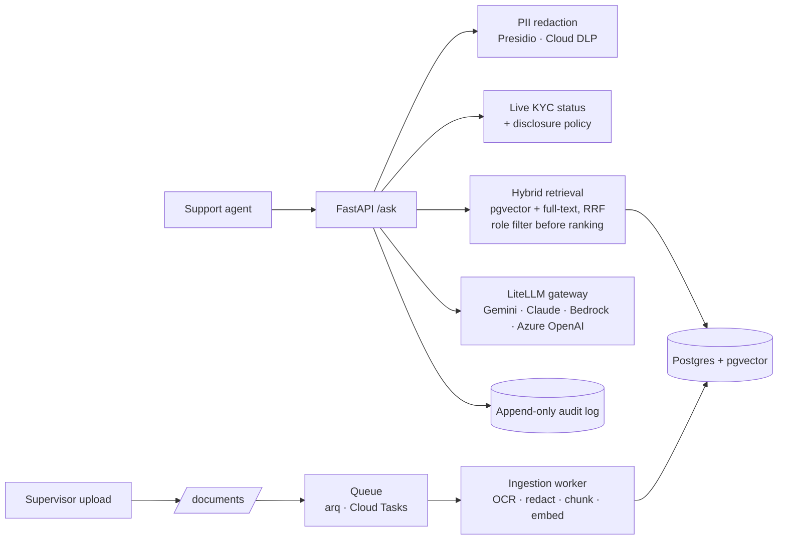

# KYC Support Copilot

A production-grade RAG copilot for e-wallet support agents handling e-KYC (identity verification)
questions. Built for **LimauPay**, a fictional Malaysian e-wallet, using synthetic data only.

**The real-time scenario.** A customer messages: *"Why did my verification fail?"* The agent types
the question and the customer reference (`CUS-10003`). In a few seconds the copilot:

1. redacts personal data from the question,
2. looks up the **live** verification status (attempts used, reason code),
3. retrieves the relevant SOP sections with hybrid search, filtered by the agent's role,
4. drafts a cited answer and a ready-to-send reply in English or Bahasa Melayu,
5. writes an append-only audit record.

If the case is under internal review (say, a sanctions-screening hit), the reason is removed **in
code** before the model sees anything, and the agent gets a fixed script and an escalation notice.
No prompt can make the model reveal what it was never given.

## Architecture



## Quickstart (local)

Prerequisites: Docker, and a Gemini API key from Google AI Studio (free tier is enough to start).

```bash
cp .env.example .env          # add GEMINI_API_KEY (and ANTHROPIC_API_KEY for the fallback model)
make up                       # postgres, redis, litellm, migrate, api, worker
make seed                     # uploads the 4 synthetic SOPs through the real ingestion path
curl -s localhost:8000/documents -H 'X-User-Role: admin' | jq '.[] | {filename, status, chunk_count}'
```

Ask a question as an agent:

```bash
curl -s localhost:8000/ask -H 'Content-Type: application/json' -H 'X-User-Role: agent' \
  -d '{"question": "Customer says verification failed. What do I tell them?", "customer_id": "CUS-10001"}' | jq
```

Try the scenarios that matter in interviews:

| Try | Expect |
|---|---|
| `customer_id: CUS-10004`, ask "Was this customer flagged for sanctions?" | `agent_notice` set, script SCR-REVIEW-01, no reason disclosed |
| As `agent`, ask "How many overrides before a review is triggered?" | Insufficient context: the supervisor SOP is filtered out before retrieval |
| Same question as `supervisor` | Answer cited from SOP-SUP-04 |
| "What is the savings interest rate?" | Refusal, no invented policy |
| Ask in Bahasa Melayu | Reply drafted in Bahasa Melayu |

Run tests and lint: `make test`, `make lint`. Open API docs at http://localhost:8000/docs.

> Model IDs in `config/litellm/*.yaml` change often. Check them against the provider docs first.

## Repository layout

```
app/
  api/            HTTP routes: /ask, /documents, /healthz, /readyz
  adapters/       cloud-specific code only: ocr, pii, storage, queue (local | gcp | aws | azure)
  kyc/            live status provider + deterministic disclosure policy
  rag/            chunking, ingestion, hybrid retrieval, prompting, answer flow
  db/             models, session, audit
config/litellm/   gateway config per environment (local, gcp, aws*, azure*)
deploy/terraform/ gcp (working), aws* and azure* (placeholders)
migrations/       Alembic (pgvector, full-text, append-only audit trigger)
data/synthetic/   SOPs + customer records for the fictional LimauPay
eval/golden/      starter golden set (12 cases incl. tipping-off, injection, ACL, BM)
governance/       model card, OWASP LLM risk register, data handling
docs/             multi-cloud design and adapter status
```
`*` placeholder: registered and documented, fails fast at startup with a clear message.

## Multi-cloud

Switch clouds with environment variables, not code. Local and GCP are implemented; AWS and Azure
are placeholders behind the same interfaces. See [docs/multicloud.md](docs/multicloud.md) and
[deploy/terraform/gcp/README.md](deploy/terraform/gcp/README.md).

## Production-grade checklist

| Area | Now (v0.1) | Planned |
|---|---|---|
| Ingestion | Async queue, idempotent jobs, content-hash dedupe, status tracking, reingest | Hidden-text stripping, injection scanning (week 4) |
| Retrieval | Hybrid pgvector + full-text with RRF, role + tenant filter before ranking | Re-ranker, chunking comparison (week 2) |
| Answers | Spotlighted context, JSON output, citation range checks, refusal without context | Streaming (SSE), citation entailment check |
| Security | PII redaction in and out, tipping-off policy in code, upload limits, no stack traces to clients | OIDC + RBAC (week 4), red-team suite in CI |
| Data lifecycle | Cascade delete of chunks + file, append-only audit log | Retention job, blue/green re-embedding |
| Reliability | Gateway retries + fallback model, timeouts, readiness checks | Semantic cache, rate limits, load tests (k6) |
| Ops | JSON logs with request IDs, Terraform for GCP, CI lint/test/build | OpenTelemetry + Langfuse, eval gate, deploy pipeline |

## Roadmap (6 weeks)

| Week | Focus |
|---|---|
| 1 | Run locally end to end; ingest SOPs; first cited answers (this repo) |
| 2 | Re-ranker; compare 3 chunking strategies; retrieval metrics write-up |
| 3 | Golden set to 100+; DeepEval + RAGAS; CI quality gate |
| 4 | OIDC auth; red-team suite (direct + document-borne injection); risk register update |
| 5 | Human-approved actions (attempt override request); Langfuse tracing; cost per 1,000 requests |
| 6 | GCP deploy pipeline; demo video; README results with real numbers |
