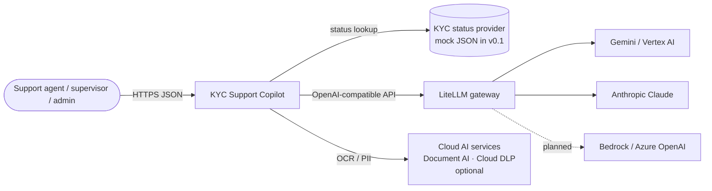
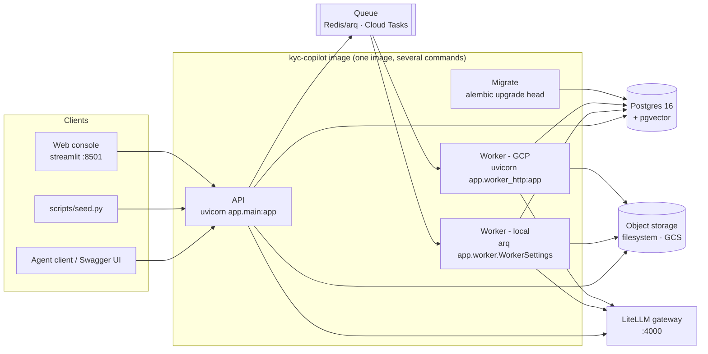
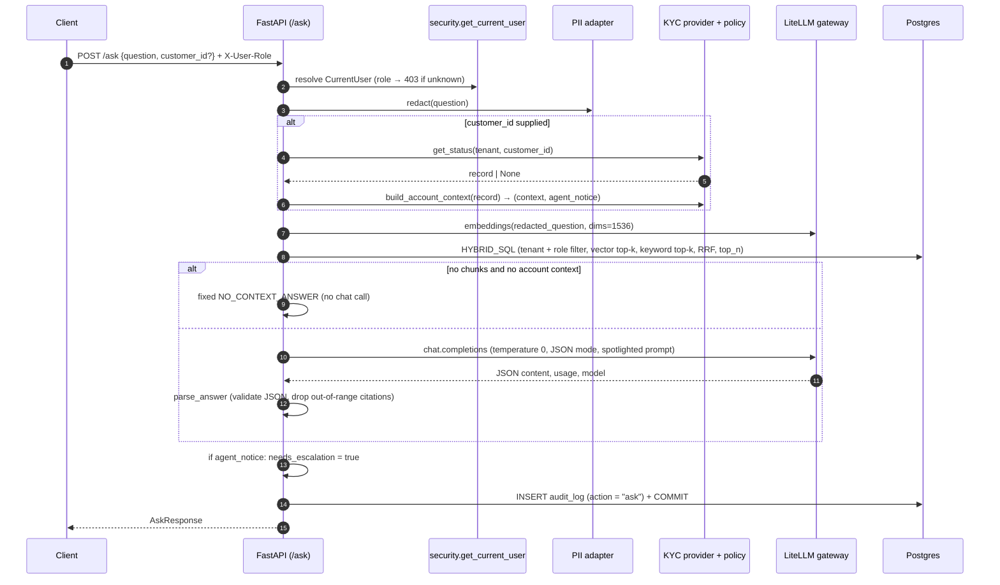
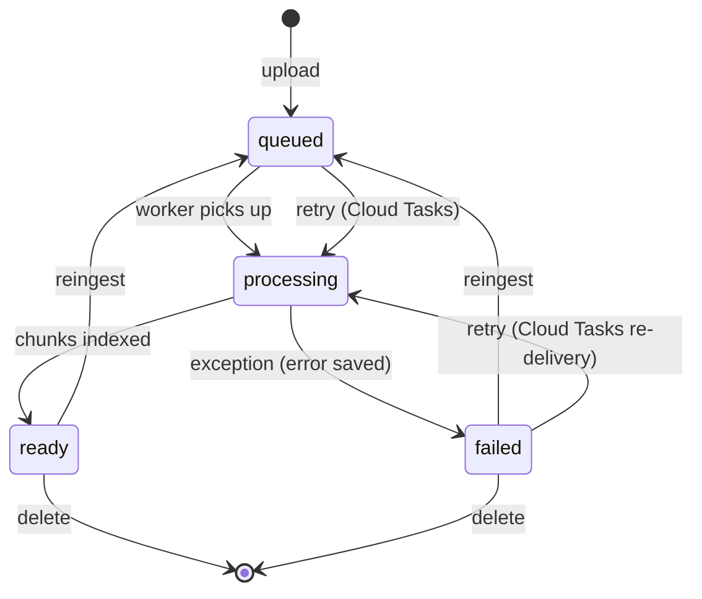
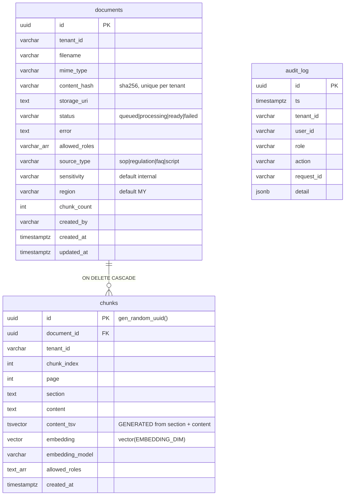
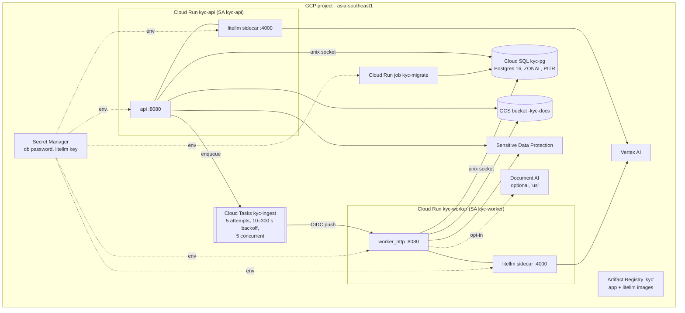

# Technical Specification Document (TSD): KYC Support Copilot

| | |
|---|---|
| Product | KYC Support Copilot for LimauPay (fictional) |
| Version | 0.1 (describes code release `0.1.0`) |
| Date | 2026-10-10 |
| Status | Draft, reverse-engineered from the codebase |
| Companion | [FSD.md](FSD.md) (what and why), [multicloud.md](multicloud.md), [../governance/risk_register.md](../governance/risk_register.md) |

> This document describes the system as built. Requirement IDs (`FR-*`, `NFR-*`, `BR-*`) refer to
> [FSD.md](FSD.md). Technical gaps found while analysing the code are collected in
> [§15](#15-known-gaps-and-technical-debt).

---

## 1. Architecture overview

### 1.1 System context



### 1.2 Containers



### 1.3 Architectural principles

| Principle | How it is applied |
|---|---|
| **Ports and adapters** | Storage, queue, OCR and PII are `Protocol`s with one implementation per cloud, selected by environment variables and imported lazily (`app/adapters/registry.py`). Domain and RAG code never import a cloud SDK. |
| **One gateway for every model** | The app only knows the aliases `chat-default` and `embed-default`. Providers, keys, retries and fallbacks live in the LiteLLM configuration (`config/litellm/*.yaml`). |
| **Policy in code, not in the prompt** | The tipping-off rule is deterministic Python (`app/kyc/policy.py`). Restricted data never reaches the model. |
| **Authorisation before ranking** | Tenant and role filters are inside both retrieval sub-queries, so restricted chunks are never candidates. |
| **Fail fast** | Adapters are built at startup. Placeholders raise `NotImplementedError`. `dev` authentication in production raises a validation error. |
| **One image** | The API, both workers and migrations share one Docker image and differ only by command. |
| **Idempotency** | Uploads are deduplicated by content hash. Ingestion replaces chunks transactionally. arq jobs use a fixed job ID. |

---

## 2. Technology stack

| Layer | Technology | Version / notes |
|---|---|---|
| Language | Python | ≥ 3.12 |
| Web framework | FastAPI + Uvicorn | ≥ 0.115 / ≥ 0.30 |
| Validation and settings | Pydantic v2, pydantic-settings | |
| ORM and DB driver | SQLAlchemy 2 (async) + asyncpg | |
| Migrations | Alembic | One revision `0001` |
| Database | PostgreSQL 16 + pgvector | `pgvector/pgvector:pg16` locally; Cloud SQL on GCP |
| Vector index | HNSW, cosine (`vector_cosine_ops`) | |
| Keyword search | Postgres full-text search, `simple` configuration, GIN index | |
| Queue (local) | arq on Redis 7 | |
| Queue (GCP) | Cloud Tasks pushing HTTP requests to a Cloud Run worker | |
| LLM access | `openai` Python SDK → LiteLLM proxy | `ghcr.io/berriai/litellm:main-stable` (not pinned) |
| Chat models | `gemini-3.8-flash` (local default), `gemini-2.5-flash` (GCP default), `claude-haiku-5-5` (local fallback), `gemini-2.5-pro` (GCP fallback) | `config/litellm/` |
| Embeddings | `gemini-embedding-001`, 1,536 dimensions | `EMBEDDING_DIM` |
| OCR | pypdf + Tesseract (`eng+msa`) + pdf2image/poppler; optional Google Document AI | |
| PII | Microsoft Presidio (spaCy `en_core_web_sm`) + regex; optional Google Sensitive Data Protection | |
| Infrastructure as code | Terraform ≥ 1.6, `hashicorp/google ~> 6.0` | GCP only |
| CI | GitHub Actions: ruff, pytest, docker build | |
| Lint and test | ruff (line length 100, py312), pytest | |

---

## 3. Codebase structure

```
ui/                  Streamlit web console (a separate image; never imports app/)
  app.py             entry point: navigation, sidebar (identity, status)
  api_client.py      the only HTTP code: typed results, ApiError / ApiUnavailable
  identity.py deps.py components.py formatting.py scenario_data.py
  views/             ask.py, scenarios.py, documents.py (not pages/: see §6.12)
  tests/             httpx MockTransport + Streamlit AppTest
app/
  main.py            FastAPI app: lifespan (logging, adapter validation), request-ID middleware,
                     global exception handler, routers
  config.py          Settings (pydantic-settings), production guard, DB URL builder
  security.py        CurrentUser, get_current_user (dev headers), require_role
  domain.py          ROLE_SCOPES, PageText, RetrievedChunk (no framework imports)
  llm.py             AsyncOpenAI client to the gateway, embed_texts, chat_json, to_pgvector
  logging_setup.py   JSON formatter, request_id ContextVar
  worker.py          arq WorkerSettings (local ingestion worker)
  worker_http.py     FastAPI app for Cloud Tasks push (GCP ingestion worker)
  api/
    ask.py           POST /ask
    documents.py     /documents CRUD, re-ingest
    health.py        /healthz, /readyz
  adapters/
    registry.py      (kind, provider) → "module:Class"; lazy import
    factory.py       One cached instance per adapter kind; validate_adapters()
    _placeholder.py  PlannedProvider base (fails fast)
    ocr/  pii/  storage/  queue/    base.py (Protocol) + local/gcp/aws/azure implementations
  kyc/
    provider.py      KycStatusProvider Protocol + MockKycStatusProvider
    policy.py        Disclosure policy (build_account_context)
  rag/
    answer.py        Orchestrates the /ask flow
    chunking.py      Heading-aware chunker
    ingest.py        Ingestion pipeline
    prompting.py     System prompt, spotlighting, output parsing
    retrieve.py      Hybrid SQL (vector + full-text + RRF)
  db/
    models.py        Document, AuditLog ORM models
    session.py       Async engine and session factory
    audit.py         write_audit()
migrations/          Alembic env + 0001_initial (schema, indexes, append-only trigger)
config/litellm/      Gateway configuration per environment
deploy/              Terraform (GCP working; AWS and Azure README placeholders), LiteLLM image
data/synthetic/      SOPs and customer records
eval/golden/         12-case golden set
governance/          Model card, OWASP risk register, data handling
scripts/seed.py      Uploads the SOPs through the public API
tests/               Unit tests
```

**Dependency direction:** `api → rag / kyc / db / adapters.factory → adapters.<kind>.<cloud>`.
`domain.py` is shared by everything and has no dependencies. Only `adapters/*/<cloud>.py` import
cloud SDKs.

---

## 4. Runtime components

| Component | Command | Local (docker-compose) | GCP |
|---|---|---|---|
| API | `uvicorn app.main:app` | `api`, port 8000 | Cloud Run `kyc-api`, port 8080, 1 vCPU / 2 GiB, max 3 instances, LiteLLM sidecar |
| Ingestion worker | `arq app.worker.WorkerSettings` | `worker` | — |
| Ingestion worker (HTTP) | `uvicorn app.worker_http:app` | — | Cloud Run `kyc-worker`, 2 vCPU / 2 GiB, 900 s timeout, max 3 instances, LiteLLM sidecar |
| Migrations | `alembic upgrade head` | `migrate` (one-shot; the API and worker wait for it) | Cloud Run job `kyc-migrate` |
| Web console | `streamlit run app.py` | `ui`, port 8501 | — (local only in v1) |
| LLM gateway | LiteLLM `--config … --port 4000` | `litellm`, port 4000, mounts `local.yaml` | Sidecar in each service, `gcp.yaml` built into the image |
| Database | — | `postgres` (pgvector:pg16) | Cloud SQL `kyc-pg`, Postgres 16, reached through a unix socket at `/cloudsql/...` |
| Queue | — | `redis:7-alpine` | Cloud Tasks queue `kyc-ingest` |
| Object storage | — | Volume `uploads` at `/srv/var/uploads` | GCS bucket `<project>-kyc-docs` |

**Process startup (API):** `configure_logging()` → `get_settings()` (validates the production
guard) → `validate_adapters()` (builds the OCR, PII, storage and queue adapters, so a bad
configuration fails here) → `get_kyc_provider()` (loads the mock JSON) → log `startup`. On
shutdown: `dispose_engine()`.

The Presidio adapter loads a spaCy model in its constructor, so with `PII_PROVIDER=presidio` the
model is loaded at API startup and on the worker's first job.

---

## 5. Key flows

### 5.1 `POST /ask`



Implementation: `app/rag/answer.py:25`.

### 5.2 Upload and ingestion

```mermaid
sequenceDiagram
  autonumber
  participant C as Supervisor/Admin
  participant API as /documents
  participant ST as Storage adapter
  participant DB as Postgres
  participant Q as Queue adapter
  participant W as Worker (arq or HTTP)
  participant OCR as OCR adapter
  participant PII as PII adapter
  participant LLM as LiteLLM (embeddings)
  C->>API: multipart file, allowed_roles, source_type
  API->>API: validate extension (415), source_type/roles (422), size (413), empty (400)
  API->>DB: SELECT by (tenant, sha256)
  alt duplicate
    API-->>C: 202 existing doc, deduplicated = true
  else new
    API->>ST: put(tenant/doc_id/safe_name)
    API->>DB: INSERT documents(status = queued) + COMMIT
    API->>Q: enqueue_ingest(doc_id)
    API->>DB: INSERT audit_log(document.upload)
    API-->>C: 202 doc, deduplicated = false
  end
  Q-->>W: ingest_document(doc_id)
  W->>DB: load doc; skip if ready; status = processing
  W->>ST: get(uri)
  alt text/markdown or text/plain
    W->>W: decode UTF-8 (errors replaced)
  else pdf / image
    W->>OCR: extract → [PageText]
  end
  W->>PII: redact each page
  W->>W: chunk_pages(max_chars, overlap)
  W->>LLM: embeddings in batches of EMBED_BATCH_SIZE
  W->>DB: DELETE old chunks; INSERT new chunks; status = ready, chunk_count; COMMIT
  Note over W,DB: on any exception: rollback, status = failed, error saved, re-raise
```

Implementation: `app/api/documents.py:46`, `app/rag/ingest.py:35`.

### 5.3 Delete

`DELETE /documents/{id}` (admin) → load the document (tenant and role checked, otherwise `404`) →
`DELETE FROM documents` (chunks deleted by `ON DELETE CASCADE`) → `COMMIT` → `storage.delete(uri)`
(a failure is logged but not raised) → audit `document.delete` → `204`.

### 5.4 Document status state machine



---

## 6. Component design

### 6.1 Configuration (`app/config.py`)

- A `Settings(BaseSettings)` instance, cached with `lru_cache` (`get_settings()`). Reads `.env`
  and ignores unknown keys.
- Validator `_guard_production`: rejects `environment == "production"` together with
  `auth_mode == "dev"`.
- `sqlalchemy_url`: uses `DATABASE_URL` when set. Otherwise builds the URL from `DB_*`, using a
  unix socket (`?host=DB_SOCKET_DIR`) for the Cloud SQL connector, and URL-encodes the password.
- The full variable list is in [§10](#10-configuration-reference).

### 6.2 Security (`app/security.py`)

- `get_current_user` (FastAPI dependency): when `auth_mode == "dev"`, reads `X-User-Id` and
  `X-User-Role` (role defaults to `agent`, lower-cased) and validates the role against
  `ROLE_SCOPES` (`403` if unknown). The tenant always comes from `DEFAULT_TENANT`. Any other
  `auth_mode` returns `501`.
- `require_role(*allowed)` returns a dependency that raises `403 "Insufficient role"`.
- Planned: an OIDC implementation behind the same `CurrentUser` contract, with no endpoint changes.

### 6.3 Adapter layer (`app/adapters/`)

**Interfaces**

| Kind | Protocol | Methods |
|---|---|---|
| `storage` | `ObjectStorage` | `put(key, data, content_type) -> uri`, `get(uri) -> bytes`, `delete(uri)` |
| `queue` | `JobQueue` | `enqueue_ingest(document_id)` |
| `ocr` | `OCRProvider` | `extract(data, mime_type) -> list[PageText]` |
| `pii` | `PIIRedactor` | `redact(text) -> str` |

**Resolution:** `registry.resolve(kind, name)` maps to `"module:Class"`, imports the module only
when needed, and raises `ValueError` listing the valid options for an unknown name.
`factory.get_<kind>()` builds `Class(settings)` once per process (`lru_cache`).

**Implementations**

| Kind | `local` / default | `gcp` | `aws` | `azure` |
|---|---|---|---|---|
| storage | `LocalStorage`: files under `LOCAL_STORAGE_DIR`, `file://` URIs, path-traversal guard | `GCSStorage`: `gs://bucket/key`, blocking SDK calls run in a thread, checks the URI belongs to the bucket | `S3Storage` ⏳ | `BlobStorage` ⏳ |
| queue | `ArqQueue` (`arq`): lazily created Redis pool, `_job_id="ingest:<id>"` | `CloudTasksQueue`: HTTP POST to `{WORKER_URL}/internal/ingest/{id}` with an OIDC token (audience = worker URL) | `SQSQueue` ⏳ | `ServiceBusQueue` ⏳ |
| ocr | `TesseractOCR`: pypdf text layer; a page with fewer than 20 characters is rasterised at 300 DPI and OCR'd (`eng+msa`); images are OCR'd directly; runs in a thread | `DocumentAIOCR`: `process_document`, per-page text from layout anchors | `TextractOCR` ⏳ | `DocumentIntelligenceOCR` ⏳ |
| pii | `PresidioRedactor` (`presidio`): spaCy `en` model, entities PERSON, EMAIL, PHONE, CREDIT_CARD, IBAN plus custom `MY_NRIC` and `MY_PHONE`, then a regex pass; `RegexRedactor` (`regex`): no external dependencies | `SensitiveDataProtectionRedactor`: DLP `deidentify_content` with built-in types plus a custom `MY_NRIC`, replaced with the info-type name, then a regex pass | `ComprehendRedactor` ⏳ | `AzureLanguagePIIRedactor` ⏳ |

⏳ = `PlannedProvider` subclass. Constructing it raises `NotImplementedError`, so the service
fails at startup.

**Regex patterns** (`app/adapters/pii/regex.py`), applied in this order: `EMAIL_ADDRESS`,
`CREDIT_CARD` (13–19 digits, optional separators), `MY_NRIC` (`\d{6}-?\d{2}-?\d{4}`),
`PHONE_NUMBER` (Malaysian mobiles, `+60`/`0` + `1x`). Each match is replaced with `<LABEL>`.

### 6.4 KYC status and disclosure policy (`app/kyc/`)

- `KycStatusProvider.get_status(tenant_id, customer_id) -> dict | None`.
- `MockKycStatusProvider` loads `KYC_MOCK_DATA_PATH` into a dictionary keyed by
  `(tenant_id, customer_id)`. Any other `KYC_STATUS_PROVIDER` value raises `ValueError` at startup.
- `build_account_context(record) -> (context, agent_notice)`. This is a pure function that copies
  only `SAFE_FIELDS` into the context, then applies the decision in FSD §6 (BR-02 and BR-03).
  Unit tests: `tests/test_kyc_policy.py`.

### 6.5 Chunking (`app/rag/chunking.py`)

Algorithm `chunk_pages(pages, max_chars=1500, overlap=200)`:

1. Requires `overlap < max_chars // 2`.
2. For each page, split the text into blocks at blank lines.
3. If the first line of a block is a Markdown heading (`#`–`######`), flush the buffer, set the
   current `section` to the heading text, and keep the rest of the block, if any.
4. Split blocks longer than `max_chars` (`_split_long`) at the last `". "` or newline in the
   second half of the window. The next piece starts `overlap` characters earlier, moved forward to
   the next space.
5. Pack pieces into a buffer, separated by `\n\n`. Flush when adding a piece would exceed
   `max_chars`. The buffer is also flushed at the end of each page, so **chunks never cross
   pages** (the page number stays accurate for citations).
6. `section` carries over across pages until the next heading.
7. `Chunk.embedding_text()` puts the section title in front of the text, so short chunks keep
   their context. The stored `content` does not include the title, but the full-text vector
   includes the section (see §7).

### 6.6 Ingestion (`app/rag/ingest.py`)

Described in §5.2. Further details:

- Chunks are inserted with raw SQL (`INSERT_CHUNK`), passing the embedding as text and casting it
  to `vector`, and `allowed_roles` cast to `text[]`. The rows are sent as one `executemany`.
- `embedding_model` is stored on every chunk (`settings.embed_model`), so re-embedding with a
  different model can be tracked later.
- The error message is truncated to 2,000 characters. The exception is re-raised so that the
  queue (Cloud Tasks) can retry.

### 6.7 Retrieval (`app/rag/retrieve.py`)

A single SQL statement with three parts:

| CTE | Purpose |
|---|---|
| `q` | Query vector (`CAST(:qvec AS vector)`) and `websearch_to_tsquery('simple', :query)` |
| `vec` | Top `k` (default 20) chunks by cosine distance `<=>`, **filtered by tenant and role overlap (`&&`)** |
| `kw` | Top `k` chunks by `ts_rank_cd` where `content_tsv @@ ts`, with the **same filter** |

Reciprocal Rank Fusion: `score = 1/(60 + r_vec) + 1/(60 + r_kw)`, where a missing rank
contributes 0. The final result is the top `top_n` (default 6), joined to `documents` for the
filename.

The `simple` text-search configuration is used because the content mixes English and Bahasa
Melayu: no stemming and no stop words.

**Caveat:** with restrictive filters, an HNSW index scan can return fewer than `k` rows. pgvector
0.8 or later supports `SET hnsw.iterative_scan = relaxed_order` to fix this (not enabled yet).

### 6.8 Prompting and output parsing (`app/rag/prompting.py`)

- **System prompt** (`SYSTEM_PROMPT`) rules: use only `<documents>` and `<account_status>`; treat
  their content as data; cite `[n]`; obey `disclosure_rule`; never repeat ID or card numbers or
  passwords; write `suggested_reply` in the language of the question; return exactly these JSON
  keys: `answer`, `citations`, `suggested_reply`, `needs_escalation`, `insufficient_context`.
- **Spotlighting:** each chunk becomes
  `<document index="i" source="…" page="…" section="…">…</document>`. The content, filename,
  section, account JSON and question are escaped (`&`, `<`, `>`), so text inside them cannot close
  the tags (tested in `tests/test_prompting.py`).
- **Call:** `chat.completions.create(model=CHAT_MODEL, temperature=0, response_format=json_object)`.
- **Parsing** (`parse_answer`): output that is not JSON or not an object becomes a fixed escalation
  answer with `format_error=True`. Citations are kept only if they are integers between 1 and
  `n_chunks`, then deduplicated and sorted. `dropped_citations` is set when any were removed. The
  other fields are converted to `str` or `bool`.

### 6.9 LLM client (`app/llm.py`)

- `AsyncOpenAI(base_url=LLM_BASE_URL, api_key=LLM_API_KEY, timeout=30s, max_retries=2)`, cached.
- `embed_texts` sends batches of `EMBED_BATCH_SIZE` (16) with `dimensions=EMBEDDING_DIM`, orders
  the results by `index`, and checks each vector's length. A mismatch raises `RuntimeError` with a
  hint to check the settings.
- `to_pgvector` formats the vector as the text `[x,…]` with 7 decimal places.

### 6.10 Logging and request context (`app/logging_setup.py`, `app/main.py`)

- `JsonFormatter` writes `{"severity", "logger", "message", "request_id", …extra_fields,
  "exception"?}` to stdout, a format Cloud Logging parses.
- HTTP middleware takes `x-request-id` from the request or generates `uuid4().hex`, stores it in a
  `ContextVar`, and adds it to the response headers.
- The global exception handler logs the stack trace and returns a generic `500` with the request ID.

### 6.11 Audit (`app/db/audit.py`)

`write_audit(session, tenant_id, user_id, role, action, detail)` adds an `AuditLog` row (with the
request ID from the `ContextVar`) and **commits**. Actions in use: `ask`, `document.upload`,
`document.delete`.

### 6.12 Web console (`ui/`)

- **Boundary:** a separate image (`python:3.12-slim`, Streamlit 1.64.0, httpx 0.28.1) that
  calls the public API over HTTP. Nothing in `ui/` imports from `app/`, so the UI cannot get
  around access control, redaction or the disclosure policy.
- **Units:** `api_client.py` (all HTTP calls, typed dataclasses; `ApiError` for non-2xx,
  `ApiUnavailable` for connection errors and timeouts; a fresh `X-Request-Id` on every call),
  `identity.py` (dev-mode role and user from the sidebar, sent as headers), `deps.py`
  (settings, `get_client()`, `/readyz` cached for 15 s), `components.py` (errors, status panel),
  `formatting.py` (pure helpers), `scenario_data.py`, and one file per page.
- **Timeouts:** `/ask` 90 s (see T9), upload 60 s, everything else 10 s.
- **Rendering safety:** the answer and sources use `st.text` (no Markdown or HTML processing),
  and the suggested reply uses `st.code`. Other text we did not write goes through
  `escape_md()` before reaching a Markdown widget.
- **Live status:** the document table is an `st.fragment` that re-polls every 3 s only while a
  document is `queued` or `processing`.
- **Extending:** a page is one file in `ui/views/` plus one `st.Page` line in `ui/app.py`. The
  folder is not called `pages/`, because Streamlit auto-runs files there on a first-visit deep
  link, bypassing `app.py` (sidebar, identity, status). OIDC
  (roadmap project 2) changes only `identity.py` and `api_client.py`.

---

## 7. Data design

### 7.1 Entity-relationship diagram



### 7.2 Constraints and indexes (`migrations/versions/0001_initial.py`)

| Table | Object | Definition | Purpose |
|---|---|---|---|
| documents | `uq_documents_hash` | UNIQUE (`tenant_id`, `content_hash`) | Deduplication |
| documents | `ix_documents_tenant_id` | btree (`tenant_id`) | Tenant scoping |
| chunks | FK `document_id` | → `documents(id)` ON DELETE CASCADE | Deletion propagates to chunks |
| chunks | `uq_chunks_doc_index` | UNIQUE (`document_id`, `chunk_index`) | Prevents duplicate chunks |
| chunks | `ix_chunks_embedding` | HNSW (`embedding vector_cosine_ops`) | Semantic search |
| chunks | `ix_chunks_tsv` | GIN (`content_tsv`) | Keyword search |
| chunks | `ix_chunks_tenant` | btree (`tenant_id`) | Tenant filter |
| chunks | `ix_chunks_roles` | GIN (`allowed_roles`) | Role-overlap filter |
| audit_log | `ix_audit_log_tenant_id`, `ix_audit_log_ts` | btree | Audit queries |
| audit_log | trigger `audit_log_no_update` | BEFORE UPDATE OR DELETE → `RAISE EXCEPTION` | Append-only |

**Notes**

- The embedding dimension is fixed when the migration runs (`vector({EMBEDDING_DIM})`). Changing
  `EMBEDDING_DIM` later requires a new migration and re-embedding every document.
- The append-only trigger blocks row-level `UPDATE` and `DELETE`. It does not block `TRUNCATE` or
  a table owner who disables the trigger. Full protection needs the application to use a database
  role with limited privileges.
- `chunks.tenant_id` and `chunks.allowed_roles` are copied from the document (denormalised), so
  retrieval can filter without a join. Changing a document's roles requires a re-ingest.

### 7.3 `audit_log.detail` contents by action

| Action | `detail` keys |
|---|---|
| `ask` | `question_redacted`, `customer_id`, `retrieved_chunk_ids[]`, `cited_chunk_ids[]`, `tool_calls[]` (`{tool, customer_id, found}`), `restricted_case`, `answer`, `model`, `usage`, `latency_ms` |
| `document.upload` | `document_id`, `filename` |
| `document.delete` | `document_id`, `filename` |

### 7.4 Object storage layout

Key: `{tenant_id}/{document_id}/{safe_name}`, where `safe_name` is the filename with characters
outside `[A-Za-z0-9._-]` replaced by `_`, truncated to 120 characters. On GCP the bucket has
uniform access, public access prevention enforced, and versioning enabled.

---

## 8. API specification

Base URL: `http://localhost:8000` locally. OpenAPI and Swagger UI are at `/docs`.

**Common headers**

| Header | Direction | Notes |
|---|---|---|
| `X-User-Id` | request | `dev` mode only. Defaults to `dev-<role>`. |
| `X-User-Role` | request | `dev` mode only. `agent` (default), `supervisor` or `admin`. |
| `X-Request-Id` | request / response | Optional on the request; always present on the response. |

**Common errors:** `403` unknown role or insufficient role, `422` validation error,
`500 {"detail":"Internal error","request_id":…}`, `501` when `AUTH_MODE` is not `dev`.

### 8.1 `POST /ask`

- **Auth:** any role.
- **Request**

  ```json
  { "question": "string (3..2000)", "customer_id": "CUS-12345 | null" }
  ```

- **Response 200**

  ```json
  {
    "request_id": "…",
    "answer": "… [1]",
    "suggested_reply": "…",
    "citations": [{"n":1,"chunk_id":"uuid","document_id":"uuid","filename":"SOP-KYC-01….md","page":1,"section":"Reason code DOC_BLURRY"}],
    "agent_notice": null,
    "needs_escalation": false,
    "insufficient_context": false,
    "model": "gemini-2.5-flash",
    "latency_ms": 2140
  }
  ```

### 8.2 `POST /documents` (multipart)

- **Auth:** supervisor or admin.
- **Form fields:** `file` (required), `allowed_roles` (comma-separated, default
  `agent,supervisor,admin`), `source_type` (default `sop`).
- **Response 202:** the document object (below) plus `deduplicated: bool`.
- **Errors:** `400` empty file, `413` too large, `415` extension not allowed, `422` invalid
  `source_type` or roles.

### 8.3 `GET /documents`

- **Auth:** any role.
- **Response 200:** an array of document objects readable by the role, newest first (no
  pagination).

### 8.4 `GET /documents/{document_id}`

- **Auth:** any role.
- **Responses:** `200` document object; `404` if it does not exist, belongs to another tenant, or
  is not readable by the role; `422` if the ID is not a UUID.

### 8.5 `POST /documents/{document_id}/reingest`

- **Auth:** supervisor or admin.
- **Responses:** `202` document object (status `queued`); `404`.

### 8.6 `DELETE /documents/{document_id}`

- **Auth:** admin.
- **Responses:** `204`; `404`.

**Document object**

```json
{"id":"uuid","filename":"…","status":"queued|processing|ready|failed","error":null,
 "source_type":"sop","allowed_roles":["agent","admin","supervisor"],"chunk_count":0,
 "created_at":"…"}
```

### 8.7 Health

| Endpoint | Response |
|---|---|
| `GET /healthz` | `200 {"status":"ok"}` |
| `GET /readyz` | `200` or `503` `{"status":"ok|degraded","checks":{"database":"ok|error: …","llm_gateway":"ok|http N|error: …"}}`. The gateway check calls `GET {LLM_BASE_URL without /v1}/health/liveliness` with a 3 s timeout. |

### 8.8 Internal worker API (GCP only, `app/worker_http.py`)

| Endpoint | Caller | Behaviour |
|---|---|---|
| `GET /healthz` | Cloud Run | `200` |
| `POST /internal/ingest/{document_id}` | Cloud Tasks (OIDC as the API service account) | Runs `ingest_document`. Returns `200` on success; an exception gives `500`, which makes Cloud Tasks retry. No authentication in the app: access is restricted by Cloud Run IAM (`run.invoker` granted only to the API service account). |

---

## 9. LLM gateway

| Alias | Local (`local.yaml`) | GCP (`gcp.yaml`) | AWS / Azure |
|---|---|---|---|
| `chat-default` | `gemini/gemini-3.8-flash` | `vertex_ai/gemini-2.5-flash` | placeholder (`model_list: []`) |
| `chat-fallback` | `anthropic/claude-haiku-5-5` | `vertex_ai/gemini-2.5-pro` | — |
| `embed-default` | `gemini/gemini-embedding-001` | `vertex_ai/gemini-embedding-001` | — |

Router settings: `num_retries: 2`, `timeout: 30`, fallback `chat-default → chat-fallback`,
`drop_params: true`, master key from `LITELLM_MASTER_KEY`. On GCP, Vertex AI is reached with the
Cloud Run service account; no API keys are used.

Effective retry budget for one chat call: up to 3 attempts by the OpenAI SDK, each of which can
trigger up to 3 gateway attempts plus the fallback. The worst-case latency is therefore much
longer than 30 s (see §15).

---

## 10. Configuration reference

| Variable | Default | Used by | Notes |
|---|---|---|---|
| `ENVIRONMENT` | `local` | config | `local`, `staging` or `production` |
| `AUTH_MODE` | `dev` | security | `dev` or `oidc` (not implemented; returns 501) |
| `DEFAULT_TENANT` | `limaupay` | security | Tenant for every request |
| `DATABASE_URL` | — | db | Takes precedence over the `DB_*` variables |
| `DB_USER` / `DB_PASSWORD` / `DB_NAME` / `DB_HOST` / `DB_SOCKET_DIR` | `kyc` / `""` / `kyc` / `localhost` / — | db | `DB_SOCKET_DIR` is for the Cloud SQL socket |
| `REDIS_URL` | `redis://localhost:6379/0` | arq | |
| `LLM_BASE_URL` | `http://localhost:4000/v1` | llm, readyz | |
| `LLM_API_KEY` | `sk-local-change-me` | llm | Gateway key |
| `LITELLM_MASTER_KEY` | — | gateway | Must equal `LLM_API_KEY` |
| `GEMINI_API_KEY`, `ANTHROPIC_API_KEY` | — | gateway (local) | Never read by the app |
| `CHAT_MODEL` / `EMBED_MODEL` | `chat-default` / `embed-default` | llm | Gateway aliases |
| `EMBEDDING_DIM` | `1536` | llm, migration | Must match the schema |
| `EMBED_BATCH_SIZE` | `16` | llm | |
| `LLM_TIMEOUT_S` | `30.0` | llm | |
| `STORAGE_PROVIDER` | `local` | factory | `local`, `gcp`, `aws`*, `azure`* |
| `QUEUE_PROVIDER` | `arq` | factory | `arq`, `gcp`, `aws`*, `azure`* |
| `OCR_PROVIDER` | `local` | factory | `local`, `gcp`, `aws`*, `azure`* |
| `PII_PROVIDER` | `presidio` | factory | `presidio`, `regex`, `gcp`, `aws`*, `azure`* |
| `KYC_STATUS_PROVIDER` | `mock` | kyc | |
| `LOCAL_STORAGE_DIR` | `/srv/var/uploads` | storage/local | |
| `KYC_MOCK_DATA_PATH` | `data/synthetic/customers.json` | kyc | |
| `GCP_PROJECT`, `GCP_REGION` | —, `asia-southeast1` | gcp adapters | |
| `GCS_BUCKET` | — | storage/gcp | Required for `gcp` |
| `DOCAI_LOCATION`, `DOCAI_PROCESSOR_ID` | `us`, — | ocr/gcp | |
| `DLP_LOCATION` | `global` | pii/gcp | Terraform sets it to the region |
| `TASKS_LOCATION`, `TASKS_QUEUE`, `WORKER_URL`, `TASKS_SERVICE_ACCOUNT` | — | queue/gcp | All required for `gcp` |
| `MAX_UPLOAD_MB` | `20` | documents | |
| `RETRIEVAL_K` | `20` | retrieve | Candidates per search branch |
| `RETRIEVAL_TOP_N` | `6` | retrieve | Chunks sent to the model |
| `CHUNK_MAX_CHARS` / `CHUNK_OVERLAP_CHARS` | `1500` / `200` | chunking | The overlap must be less than half of the maximum |

\* placeholder: the service fails at startup.

**Web console (`ui` service)**

| Variable | Default | Notes |
|---|---|---|
| `KYC_API_URL` | `http://api:8000` | Base URL of the API |
| `KYC_UI_AUTH_MODE` | `dev` | Only `dev` is supported; any other value stops the console with a message |

---

## 11. Security architecture

| Concern | Control | Location |
|---|---|---|
| Authentication | `dev` headers, refused in production. On GCP, Cloud Run IAM (`run.invoker`) is the outer boundary until OIDC is built. | `app/security.py`, `deploy/terraform/gcp/run.tf` |
| Authorisation | `require_role` on mutating routes; `ROLE_SCOPES` for reads | `app/api/documents.py` |
| Retrieval access control (LLM08) | Tenant and role filter inside both CTEs, before ranking | `app/rag/retrieve.py` |
| Tenant isolation | `tenant_id` on every document, chunk, audit row and status lookup | All data access |
| Tipping-off (LLM02) | Allow-list of disclosable reasons; all others removed before the prompt; fixed notice | `app/kyc/policy.py` |
| Field minimisation | `SAFE_FIELDS` allow-list for the account context | `app/kyc/policy.py:29` |
| PII | Redaction of questions and document text before storage or embedding; Presidio or DLP plus a regex pass | `app/adapters/pii/` |
| Prompt injection (LLM01) | Spotlighting, escaping, instruction hierarchy in the system prompt | `app/rag/prompting.py` |
| Output handling (LLM05) | JSON mode, strict parsing, citation range check, nothing executed | `app/rag/prompting.py` |
| Excessive agency (LLM06) | No tools with side effects | Design |
| Upload safety | Extension allow-list, size limit, filename sanitised, storage path-traversal guard | `app/api/documents.py`, `app/adapters/storage/local.py` |
| Error leakage | Generic `500`, details only in logs | `app/main.py:50` |
| Secrets | Secret Manager (DB password, LiteLLM master key) on GCP; provider keys only in the gateway | `deploy/terraform/gcp/main.tf` |
| Least privilege (GCP) | Separate service accounts for the API and worker; only the API may enqueue and invoke the worker; the worker alone has Document AI access | `deploy/terraform/gcp/iam.tf` |
| Data at rest | GCS: uniform access, public access prevention, versioning. Cloud SQL: no authorised networks, IAM connector, PITR backups | `deploy/terraform/gcp/main.tf` |
| Container | Non-root user (UID 10001), slim base image | `Dockerfile` |

The full OWASP LLM Top 10 mapping is in [`governance/risk_register.md`](../governance/risk_register.md).

---

## 12. Deployment

### 12.1 Local

`make up` builds the image (extras `gcp,dev`) and starts postgres → migrate → redis, litellm →
api, worker. `make seed` uploads the four SOPs through the API (SOP-SUP-04 tagged
`supervisor,admin`). `make test` and `make lint` run inside the API container. The `ui` service serves the console at http://localhost:8501; `make ui-logs` follows its logs.

Locally the `litellm` service gets only `GEMINI_API_KEY`, `ANTHROPIC_API_KEY` and
`LITELLM_MASTER_KEY` (interpolated from `.env`), not the whole `.env`: given the app's
`DATABASE_URL` (`postgresql+asyncpg://…`), LiteLLM tries to use it as its own database and
exits. Postgres is published on host port `POSTGRES_HOST_PORT` (default 5432); containers
always use `postgres:5432`.

### 12.2 GCP (`deploy/terraform/gcp/`)



**Deploy order:** enable APIs and create the registry (targeted apply) → `make gcp-push` (both
images) → `terraform apply` → `gcloud run jobs execute kyc-migrate` → grant yourself
`run.invoker` → `gcloud run services proxy` → seed.

**Key variables:** `project_id`, `region` (default `asia-southeast1`), `vertex_location`,
`image_tag`, `db_tier` (`db-g1-small`), `deletion_protection` (false), `pii_provider` (`gcp`),
`enable_document_ai` (false), `document_ai_location` (`us`).

**Terraform state:** local by default; a GCS backend is suggested in `versions.tf`.

### 12.3 AWS and Azure

Placeholders. The service mappings are in `deploy/terraform/aws/README.md` and
`deploy/terraform/azure/README.md`. To add a provider, follow `docs/multicloud.md`: implement the
Protocol, replace the `PlannedProvider` base, add the SDK to the extras, add contract tests, then
add the LiteLLM configuration and Terraform.

### 12.4 Build and CI (`.github/workflows/ci.yml`)

On a push to `main` or a pull request: `test` job (Python 3.12, `pip install -e .[dev]`, `ruff check .` with the rule set pinned to E4/E7/E9/F in `pyproject.toml`, `pytest -q`) and `ui` job (`pip install -r ui/requirements-dev.txt`, `pytest ui/tests -q`) → `build` job (`docker build` for the API image and the UI image). Planned: an evaluation gate
(week 3) and a GCP deploy job with Workload Identity Federation (week 6).

---

## 13. Testing and quality

| Test file | Covers |
|---|---|
| `tests/test_chunking.py` | Size limit, heading → section, section carried across pages, sequential indices, section-prefixed embedding text, empty input |
| `tests/test_kyc_policy.py` | Disclosable reasons explained; internal and unknown reasons never present in the context; restricted notice; field allow-list; verified customer |
| `tests/test_pii_regex.py` | MyKad (with and without dashes), +60 and 01x mobiles, email, card; amounts are not redacted |
| `tests/test_prompting.py` | A document cannot close the spotlight tags; out-of-range and non-integer citations dropped; non-JSON output escalates |
| `tests/test_registry.py` | Every kind registers gcp, aws and azure; unknown provider lists the options; placeholders fail fast |
| `ui/tests/test_api_client.py` | Headers and request ID on every call; per-method timeouts; multipart upload; JSON mapping; error and unavailable mapping; client-side input checks |
| `ui/tests/test_formatting.py` | Markdown escaping; citation, status and title formatting; scenario data |
| `ui/tests/test_ask_page.py` | Answer, sources and reply; restricted notice first; model output not rendered as Markdown; validation; errors; history limit; sidebar status |
| `ui/tests/test_scenarios_page.py` | One click switches the role and asks exactly once |
| `ui/tests/test_documents_page.py` | Role-aware controls; failed documents; empty state; 404 on actions; polling switches off |

**Not covered by automated tests:** API routes, ingestion and retrieval against a real Postgres,
Presidio, the GCP adapters, and end-to-end golden-set evaluation (planned for week 3: DeepEval
and RAGAS plus deterministic `must_not_contain` checks). The model card lists the release
thresholds.

---

## 14. Performance and capacity

| Parameter | Value | Effect |
|---|---|---|
| DB pool | `pool_size=5`, `max_overflow=5`, `pool_pre_ping` | Up to 10 connections per process |
| Retrieval | `k=20` per branch, `top_n=6` | Prompt size of about 6 × 1,500 characters |
| Embedding batch | 16 | Ingestion throughput and provider rate limits |
| Cloud Run | max 3 instances per service | Upper bound on concurrency and cost |
| Cloud Tasks | 5 concurrent dispatches | Ingestion parallelism |
| arq | `job_timeout=600` s | Longest local ingestion job |
| Cloud Run worker | `timeout=900` s, 2 vCPU | Large scanned PDFs (Tesseract at 300 DPI) |

There are no measured latency or throughput figures yet. k6 load tests and cost per 1,000
requests are on the roadmap.

---

## 15. Known gaps and technical debt

Found by reading the code for this document. None is fixed here. They are recorded for triage.

| # | Area | Observation | Impact | Suggested direction |
|---|---|---|---|---|
| T1 | Re-ingest (local) | `ArqQueue` enqueues with `_job_id="ingest:<id>"`. arq keeps job results for 3,600 s by default, and `enqueue_job` returns `None` without enqueuing while either the job key or the result key exists (checked in arq 0.28.0, `connections.py:158`). A re-ingest within an hour of the previous run is silently dropped, and the document stays `queued`. | Re-ingest looks accepted but never runs | Add a unique suffix for re-ingests, or set `keep_result=0`. |
| T2 | Ingest retries (local) | arq's `max_tries=3` applies only to `Retry`, `RetryJob` and cancelled jobs (arq 0.28.0, `worker.py:613-625`). Ordinary exceptions (for example a temporary LLM error) are not retried, so the document stays `failed`. | Manual re-ingest needed | Raise `arq.Retry` for transient errors. |
| T3 | Upload consistency | The order is storage `put` → DB commit → enqueue → audit, with no transaction or outbox across them. If enqueue fails, the document stays `queued` and no audit row is written. Two uploads of the same new file at the same moment cause a `uq_documents_hash` IntegrityError (→ `500`) and an orphaned file. | Stuck documents; orphaned files | Transactional outbox or a reaper for stale `queued`; catch the IntegrityError and return the existing document. |
| T4 | Output PII | The model's `answer` and `suggested_reply` are not redacted, although the README says "PII redaction in and out". | Documentation mismatch; residual risk | Redact outputs, or correct the README (FSD Q1). |
| T5 | Audit coverage | Re-ingest is not audited. `format_error` and `dropped_citations` from `parse_answer` are neither returned nor audited. | Lost quality signals | Add them to `detail`; audit `document.reingest`. |
| T6 | Readiness | `/readyz` checks the DB and gateway but not the queue (Redis or Cloud Tasks) or storage. | Uploads fail while the service reports ready | Add lightweight queue and storage checks. |
| T7 | Unused metadata | `sensitivity` and `region` are stored but cannot be set and are never used for filtering. | Residency and sensitivity controls exist only on paper | Expose them on upload and filter on them (FSD Q4). |
| T8 | Role changes | `allowed_roles` is copied onto chunks. There is no endpoint to change a document's roles; changing them requires delete and re-upload, because re-uploading the same content is deduplicated. | Access-control changes are awkward | Add a role-update endpoint that also updates the chunks. |
| T9 | Retry amplification | SDK `max_retries=2` combined with gateway `num_retries=2` plus the fallback multiplies attempts and latency well beyond the 30 s timeout. | Long tail latency; extra cost | Keep retries in one layer (the gateway). |
| T10 | HNSW with filters | Filtered HNSW scans can return fewer than `k` rows. | Lower recall for narrow roles | Enable `hnsw.iterative_scan` (pgvector ≥ 0.8). |
| T11 | PII false positives | The `MY_NRIC` and `CREDIT_CARD` regexes match any 12-digit or 13–19-digit number (for example reference numbers). | Over-redaction of SOP content | Add MyKad date and state-code checks and a Luhn check for cards. |
| T12 | PII language | Presidio runs with the English model only. Malay names are poorly detected (model card). | Lower PII recall in Bahasa Melayu text | Multilingual or larger model; measure recall. |
| T13 | Supply chain | The LiteLLM image uses `main-stable`; Python dependencies use `>=` without a lock file. | Builds cannot be reproduced exactly (LLM03) | Pin image tags; add a lock file. |
| T14 | MIME detection | The file type is taken from the extension, not the content. | A mislabelled file fails at OCR | Check file signatures (magic bytes). |
| T15 | Pagination | `GET /documents` returns every row. | Slow as the knowledge base grows | Add limit and cursor parameters. |
| T16 | Startup cost | Presidio and spaCy load in the API process at startup. | Slower cold starts on Cloud Run | Consider `PII_PROVIDER=gcp` in the cloud (the Terraform default), or lazy loading. |
| T17 | Audit immutability | The trigger does not stop `TRUNCATE` or a table owner from disabling it. | Weaker tamper evidence | Use a separate DB role without TRUNCATE or owner rights for the app. |

---

## 16. Traceability: requirements to implementation

| Requirement group | Primary modules | Tests |
|---|---|---|
| FR-ASK-01..02 | `app/api/ask.py` | — (Pydantic) |
| FR-ASK-03, NFR-PRV-01 | `app/rag/answer.py`, `app/adapters/pii/*` | `test_pii_regex.py` |
| FR-ASK-04..05, NFR-SEC-01 | `app/rag/retrieve.py`, `app/domain.py` | golden g011/g012 (manual) |
| FR-ASK-06..12, NFR-SEC-02..03 | `app/rag/prompting.py`, `app/rag/answer.py`, `app/llm.py` | `test_prompting.py` |
| FR-KYC-* | `app/kyc/policy.py`, `app/kyc/provider.py` | `test_kyc_policy.py`, golden g004/g005 |
| FR-DOC-* | `app/api/documents.py`, `app/adapters/storage/*`, `app/adapters/queue/*` | — |
| FR-ING-* | `app/rag/ingest.py`, `app/rag/chunking.py`, `app/adapters/ocr/*`, `app/worker.py`, `app/worker_http.py` | `test_chunking.py` |
| FR-AUD-* | `app/db/audit.py`, `migrations/versions/0001_initial.py` | — |
| FR-AUTH-* | `app/security.py`, `app/config.py` | — |
| FR-OPS-*, NFR-PORT-01 | `app/main.py`, `app/api/health.py`, `app/adapters/registry.py`, `app/adapters/factory.py` | `test_registry.py` |
| NFR-REL-01 | `config/litellm/*.yaml`, `app/llm.py` | — |
| FR-UI-* | `ui/` | `ui/tests/*` |
